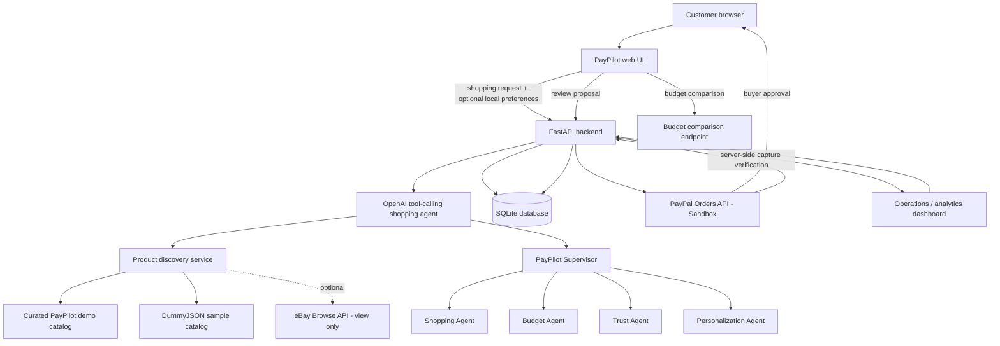

# PayPilot — Agentic AI Commerce Assistant with Human-Approved PayPal Checkout

PayPilot is a prototype AI shopping assistant that converts natural-language shopping intent into grounded product discovery, budget-aware comparisons, a reviewable order proposal, and a customer-approved PayPal Sandbox checkout.

## What it demonstrates

- Natural-language shopping requests through an OpenAI-powered agent when configured.
- Product discovery from a curated PayPilot demo catalog and DummyJSON sample catalog; optional eBay Browse API listings can be displayed as external, view-only results when configured.
- Budget comparison for USD-priced results.
- A hybrid specialist-agent workflow:
  - Shopping Agent reviews retrieved product results.
  - Budget Agent applies an explicit spending limit when one is present.
  - Trust Agent distinguishes PayPilot checkout-eligible demo items from external seller listings.
  - Personalization Agent ranks results using customer preferences supplied by the browser.
  - PayPilot Supervisor coordinates the specialist checks.
- Browser-local shopping preferences (categories, brands, optional maximum USD budget), with a Clear control.
- Order proposal review and PayPal Orders API Sandbox checkout.
- Persistent order/payment records and an operations dashboard.

## Important prototype boundaries

- PayPal is configured for **Sandbox testing**, not live money movement.
- A Sandbox payment is not a real purchase.
- DummyJSON is sample/demo product data; it does not prove live stock, current retailer pricing, delivery availability, or merchant fulfilment.
- Optional eBay results are external marketplace listings and are not eligible for PayPilot checkout. Customers must follow the seller listing.
- The specialist agents are deterministic validation/coordination components around the existing AI shopping agent. Do not describe them as five independent LLMs.
- Product recommendations are not sponsored endorsements or guarantees of product quality.

## Architecture



## Technology stack

- Python 3.12
- FastAPI
- OpenAI API (tool-calling chat completion)
- PayPal Orders API (Sandbox)
- SQLAlchemy
- SQLite
- HTML, CSS, JavaScript
- DummyJSON product API
- Optional eBay Browse API integration
- Chart.js for analytics

## Local setup (Windows PowerShell)

### 1. Requirements

Install Python 3.12 and Git. Open PowerShell in the project folder.

### 2. Create and activate a virtual environment

```powershell
py -3.12 -m venv .venv
.venv\Scripts\Activate.ps1
```

If PowerShell blocks activation for this terminal session:

```powershell
Set-ExecutionPolicy -Scope Process -ExecutionPolicy Bypass
.venv\Scripts\Activate.ps1
```

### 3. Install dependencies

```powershell
python -m pip install --upgrade pip
pip install -r requirements.txt
```

### 4. Configure environment variables

Copy `.env.example` to `.env` and fill in your own credentials locally.

- `OPENAI_API_KEY`: OpenAI API key.
- `OPENAI_MODEL`: model name supported by the configured OpenAI account.
- `PAYPAL_CLIENT_ID` and `PAYPAL_CLIENT_SECRET`: PayPal Sandbox REST app credentials.
- `PAYPAL_BASE_URL`: use the PayPal Sandbox API host for Sandbox testing.
- Optional eBay credentials are only needed if the eBay integration is enabled.

Never commit `.env`, API keys, client secrets, access tokens, or database files.

### 5. Run the app

```powershell
python -m uvicorn app.main:app --reload --host 127.0.0.1 --port 8000
```

Open:

- Customer app: http://127.0.0.1:8000/
- Operations dashboard: http://127.0.0.1:8000/admin
- API health: http://127.0.0.1:8000/api/health
- API docs: http://127.0.0.1:8000/docs

## Demo walkthrough

1. Open the customer app and ask for a product, e.g. `Find wireless headphones under $150`.
2. Review product cards and their source labels.
3. Inspect the agent activity trace. The budget specialist should run only when an explicit budget is detected.
4. Save optional preferences such as category `audio`, brand `Sony`, and a maximum budget. Search again and inspect the Personalization Agent result.
5. Add a checkout-eligible PayPilot/DummyJSON demo item to the order proposal.
6. Review the cart total.
7. Continue to PayPal Sandbox, approve the test payment using a Sandbox buyer account, and return to PayPilot.
8. Confirm the server verifies the capture and records the order.
9. Open Operations & analytics to inspect order/payment events.

Do not use real payment credentials or claim Sandbox transactions are real purchases.

## Environment variable template

See `.env.example`. The file intentionally contains placeholders only.

## Repository hygiene

The repository should include:
- Source code
- `README.md`
- `LICENSE`
- `.gitignore`
- `.env.example`
- Architecture diagram / documentation

It must not include:
- `.env`
- `.venv/`
- `__pycache__/`
- `*.db` or `data/` database files
- private keys, tokens, passwords, or real customer data

## Known limitations

- Product discovery quality depends on connected source results and upstream API availability.
- DummyJSON is sample data and is not a live inventory source.
- PayPal Sandbox validates the integration flow but does not demonstrate live-money settlement.
- eBay listings, if enabled, are view-only in this prototype.
- Personal preferences are stored in the current browser's local storage. Clearing browser storage or using another browser/device removes or does not share them.
- The specialist-agent layer is a hybrid orchestration workflow, not a set of independently hosted LLM agents.

## License

See `LICENSE`.
